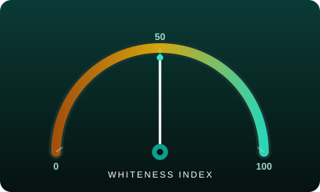

<div align="center">

# 🦷 teewai

**AI-powered oral care companion — a 0-to-100 smile score from a single photo.**




</div>

---

> Teewai turns a smartphone photo of your teeth into an instant, clinically-inspired whiteness reading. Using computer vision and the **VITA shade guide**, it scores your smile from **0 to 100**, maps it to a dental shade, and tracks how your daily diet stains your enamel over time.

## ✨ Why Teewai

Professional shade assessment is expensive, subjective, and rarely accessible between dental visits. Teewai democratizes it — a single photo gives everyone a free, repeatable whiteness score they can track like a wellness metric, and connects that score to the foods and habits that cause it.

## 🚀 Key Features

| | Feature | What it does |
|---|---|---|
| 🎯 | **0–100 Whiteness Index** | A single, trackable score from enamel color analysis — the dental equivalent of a step count. |
| 🎨 | **VITA Shade Mapping** | Each scan is matched to the clinical VITA classical shade scale, bridging AI output and dentist language. |
| 🍫 | **Dietary Stain Tracking** | Log meals to see chromogenic, tannin, and acid loads and how they nudge your shade up or down. |
| 🧠 | **AI Care Plan** | Personalized, plain-language recommendations to protect and improve whiteness between visits. |
| 📈 | **Scan History & Trends** | Every scan is saved with its photo, score, and shade, so progress is visible over days and weeks. |
| 🔒 | **Private by Default** | Photos are stored privately and processed securely — your smile never becomes public content. |

<div align="center">



</div>

## 🛠 How It Works

```
📸  Snap        →  🧠  Analyze        →  📊  Track
photo of teeth     vision reads enamel      log diet, follow plan,
                   → VITA shade + 0–100      watch your score climb
```

1. **Snap** — Capture a well-lit photo of your front teeth with any phone camera.
2. **Analyze** — Computer vision reads enamel color and maps it to a VITA shade and a 0–100 score.
3. **Track** — Log diet, follow your care plan, and watch your whiteness trend improve over time.

## 🧰 Tech Stack

- **Frontend:** React 18 + Tailwind CSS + Vite
- **AI Vision:** Computer-vision enamel color analysis
- **Shade System:** VITA classical shade guide
- **AI Inference:** NVIDIA AI vision models
- **Storage:** Private, per-user photo storage

## 📦 Getting Started

```bash
# install dependencies
npm install

# start the dev server
npm run dev

# build for production
npm run build
```

## 📁 Project Structure

```
teewai/
├── src/
│   ├── pages/          # Landing, Dashboard, Scan, Results, Profile
│   ├── components/      # Reusable UI components
│   └── lib/            # Vision, colorimetry & shade logic
├── assets/             # Animated SVG art
└── public/             # Static assets
```

## 🌱 Roadmap

- [x] Single-photo whiteness score
- [x] VITA shade mapping
- [x] Dietary stain tracking
- [ ] Dentist review portal
- [ ] Whitening product recommendations
- [ ] Multi-member family tracking

## ⚠️ Wellness Disclaimer

Teewai provides educational insights, not a medical diagnosis. Always consult a licensed dentist for clinical decisions.

## 📄 One-Page Description

A printable one-page project description is available at [`public/teewai-one-pager.html`](./public/teewai-one-pager.html) — open it in any browser and use **Print → Save as PDF** for a clean single-page brief.

## 📜 License

MIT © Teewai

<div align="center">

**Your smile, measured.**

Made with 🦷 and computer vision

</div>